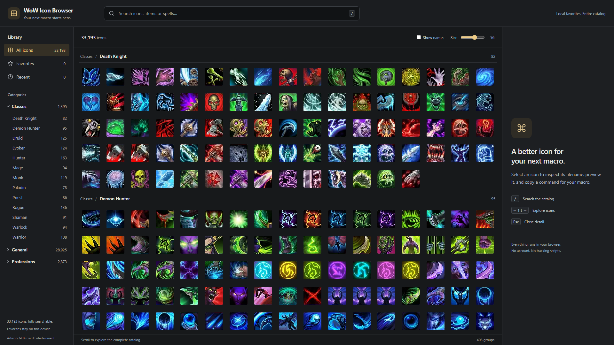
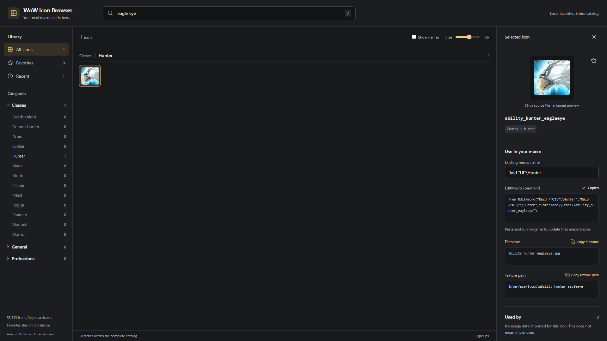
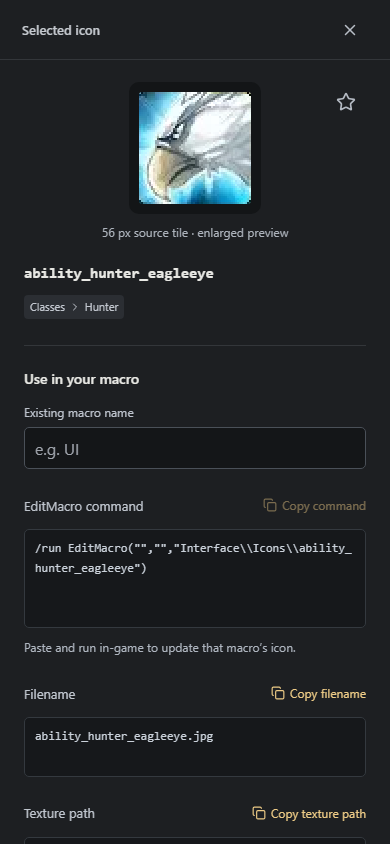

# WoW Icon Browser

A compact, browser-local tool for choosing World of Warcraft macro icons.
Search the complete catalog, browse category groups, inspect an icon, and copy
an escaped command for an existing macro.

**Demo:** https://colthreepv.github.io/wow-icon-browser/

## Run with Bun

```sh
bun install --frozen-lockfile
bun run dev
```

Open the printed URL with `/wow-icon-browser/`. Production builds use the same
repository subpath, including image assets and shareable query-string URLs.

```sh
bun run build
bun run preview
```

The browser loads generated static files from `public/`. No account, backend,
GitHub API request, analytics, third-party fonts or external tooltip script is
required. All runtime resources are same-origin; Content Security Policy also
restricts connections and images to the hosting origin. Local preferences may
be cleared by removing this site's browser storage.

## What it does

- Searches **all 33,193 imported icon names**, not only loaded thumbnails.
- Original category and subcategory groups, counts, continuous virtualized
  scrolling, adjustable icon size and optional filename labels.
- Persistent favorites, recent selections, macro name and display preferences.
- Shareable search, filters and selected icon through URL parameters.
- Docked inspector on desktop and icon drawer on mobile.
- Copies original JPG filename, derived texture path or an `EditMacro` command.
- Searches verified associated item/spell names where usage data exists.

Keyboard: `/` focuses search, arrow keys navigate the grid, `Escape` closes the
inspector. Controls expose visible focus, and copy actions report their result.

The command deliberately passes the existing macro name twice:

```lua
/run EditMacro("UI","UI","Interface\\Icons\\ability_hunter_eagleeye")
```

Quotes, backslashes and control characters in macro names are escaped as Lua
string literals. The app copies a command; run it yourself in the game.

## Source and compatibility

Pinned source: [ZHamburglar/wow-forever-icons-and-macros](https://github.com/ZHamburglar/wow-forever-icons-and-macros),
commit `207c135a931044deb51808f7a65c2aa0ec1c1be2`.

The imported source contains 33,193 JPG files totaling 60,676,471 bytes. Original
names and folder memberships are preserved. There are 32,476 distinct original
image byte sequences; identical images can share an atlas cell without losing
their separate searchable filenames. The snapshot has no duplicate filenames,
case-folded name collisions or same-name/different-content collisions.

This is a mixed WoW catalog, including Retail classes and artwork. It is **not a
Forever compatibility list**. Texture paths follow the `Interface\\Icons\\`
filename convention and are not verified against client files. No FileDataIDs
are invented. Actual texture availability and the final in-game command behavior
must be verified in the target Forever client.

`Used by` is a **partial enrichment**, currently 4,461 item/spell associations on
28 icons, prioritizing Hunter-related and commonly used images. These names are
searchable offline after metadata loads. Missing usage data means unknown, not
unused. Broader list-page retrieval was challenged by the source service, so
this release does not claim complete item/spell coverage. Source URLs and the
exact retrieval scope are recorded in `public/data/usage.json`; the application
renders no links to Wowhead and sends it no requests.

## Repeatable import

Review [NOTICES.md](NOTICES.md) before redistributing generated third-party
artwork or datasets: the source collection has no explicit license. Our MIT
license applies to original code and documentation, **not Blizzard artwork or
third-party datasets**. Attribution documents provenance; it does not grant
redistribution permission. This is an unofficial fan utility.

```sh
bun run benchmark:images
bun run import:usage
bun run import:catalog
```

The import downloads the pinned archive into ignored `.cache/`, verifies the
expected file count and byte total, retains all name/category associations,
detects collisions, and builds content-hashed WebP atlases and a compact JSON
catalog. A same-name/different-content collision fails the import with a report
rather than silently overwriting an image. No upstream gallery code is reused.

The default atlas layout is 16×16 cells (256 icons). To reproduce the smaller
8×8 variant, set `ATLAS_COLUMNS=8` in your shell before importing. Lossy WebP
quality defaults to 78 and can be changed through `ATLAS_QUALITY`.

Usage acquisition is a separate, bounded build-time operation: HTML is cached,
embedded JSON is parsed without `eval`, and item/spell associations are validated
against the exact upstream icon field. A second run reuses cached pages unless
`--refresh` is supplied. To merge a refreshed usage snapshot without re-encoding
images, run `bun scripts/merge-usage.ts`.

## Performance and verification

The renderer mounts visible rows plus a small overscan. All metadata stays
searchable; only atlases referenced by mounted cells and the inspector are
requested. Browser caches may retain images after scrolling. Virtualization
bounds DOM nodes, not the browser's entire cache.

Measured on a deterministic 256-icon sample at native 56px:

| Representation             | Files | Compressed bytes |
| -------------------------- | ----: | ---------------: |
| Original JPG               |   256 |          467,301 |
| Individual WebP quality 78 |   256 |          317,704 |
| 64-icon WebP atlases       |     4 |          272,580 |
| 256-icon WebP atlas        |     1 |          272,210 |

For the same 256 displayed images the nominal decoded RGBA footprint is about
3.06 MiB in both atlas variants. Smaller atlases reduce overfetch for scattered
results; larger ones reduce request count in sequential browsing. The shipped
desktop layout loads its first screen with one 290 KB atlas; the mixed sparse
search workload downloads more with 256 than with 64. The tradeoff and bundle,
metadata, DOM and frame measurements are documented in
[PERFORMANCE.md](docs/PERFORMANCE.md), alongside the
[sample comparison](docs/image-benchmark.json).

```sh
# Full source is cached after import; completeness tests compare with its index.
bun test tests/core.test.ts
bunx playwright install chromium
bun run build
bun run test:browser
```

Core tests compare every original category/name association with the generated
catalog, check uncapped search and relevance, and exercise adversarial Lua
strings. Browser checks cover real search/select/copy, virtualization and the
last catalog entry, URL/local-state restoration, mobile layout, failed loading,
clipboard denial and observed same-origin traffic. Screenshots are taken from
the running application.







GitHub Actions builds with Bun and deploys `dist/` through the GitHub Pages
artifact workflow. Navigation uses query parameters, so shared links work on
Pages without server-side route rewriting.
